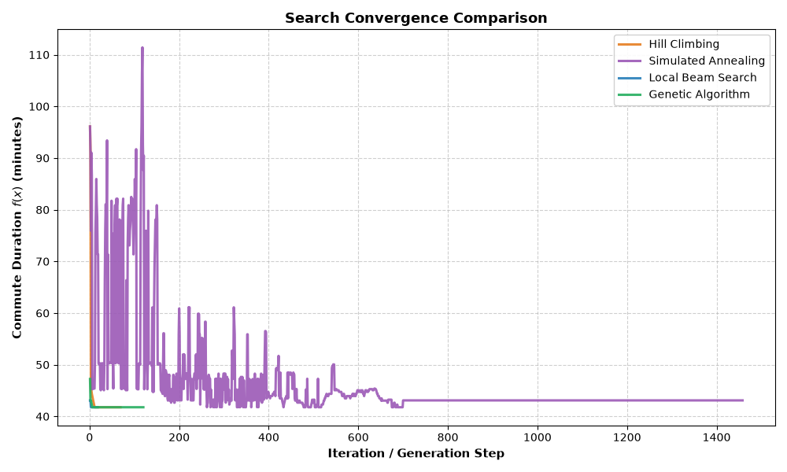

# Commute Optimizer Report

## 1. Neighborhood Operators and Loop Prevention

### Neighborhood Moves (`get_neighbors`)
To explore neighbor states, we make small changes to the current state:
1. **Departure Time:** We shift the departure time by $\pm 5$ minutes (`t_step = 5.0`), keeping it inside the valid window [465.0, 525.0].
2. **Route Changes:** We scan along the current path:
   - **Shortcut:** If a node has a direct edge to a node further down the route, we skip the intermediate nodes.
   - **1-Hop Detour:** If a node has an edge to an unvisited node ($v \notin P$) that connects back to a downstream node on the path, we insert that detour (`u -> v -> w`).

### Guaranteeing Cycle-Free Paths
We make sure paths stay loop-free:
- When picking a detour node, we strictly require `v not in path`.
- The merge node `w` must appear after node `u` in the current path order.
- Before returning any neighbor candidate, we verify `len(path) == len(set(path))` and call `problem.is_valid_state()`.

---

## 2. Results Comparison

Benchmark run on the default map (Home to Uni, 07:45 to 08:45):

| Algorithm | Best Travel Time (min) | Best Departure Time | Runtime (s) | Steps to Converge |
| :--- | :---: | :---: | :---: | :---: |
| **Hill Climbing (Restarts)** | 41.77 | 08:45 | 0.006 | ~18 |
| **Simulated Annealing** | 41.77 | 08:45 | 0.093 | ~1450 |
| **Local Beam Search** | 41.77 | 08:45 | 0.014 | ~12 |
| **Genetic Algorithm** | 41.77 | 08:45 | 0.208 | 120 (generations) |

All 4 algorithms found the exact same best route: `Home -> B1 -> B2 -> H2 -> Uni` leaving at `08:45`. 
Leaving at 08:45 makes sense in real-life senario because 08:45 is the end of the morning rush hour window in `config.json`, so roads have the least traffic!

---

## 3. Convergence Analysis

- **Hill Climbing:** Drops fast in the first 10–15 steps. Sideways moves help it move across flat areas, and random restarts help it try different start points.
- **Simulated Annealing:** At the start when temperature is high, it accepts worse costs and jumps around to avoid local minima. As it cools down, it stabilizes at the global minimum.
- **Local Beam Search (Blue):** Appears almost invisible on the plot because it converges in only ~5 to 10 steps. On an x-axis stretched to 1500 iterations by Simulated Annealing, a 10-step search is compressed into a 2-pixel vertical drop at x=0 and is visually covered by the Genetic Algorithm and Hill Climbing lines. Because the benchmark network has only 7 nodes, maintaining a beam of K=8 states explores nearly the entire combinatorial path space within the first 2–3 iterations.
- **Genetic Algorithm:** Takes longer per generation because it evaluates an entire population, but crossover allows it to jump between completely different routes in one step.

---
## 4. Analytical Questions

### Q1: Continuous Optimization & Gradient Descent
- **Why GD cannot optimize Path P:** A path on a road network is a discrete sequence of node IDs, not continuous coordinates. The gradient of the path does not exist, and you cannot take a fractional step along a graph node.
- **Conditions to optimize departure time with fixed P:** If path P is fixed, departure time is a scalar continuous variable. 1D gradient descent can optimize it if:
  1. The dynamic congestion function C_e(t) is smooth and continuously differentiable.
  2. The network satisfies the FIFO property (leaving later never gets you there earlier).
  3. The objective function is convex over [t_min, t_max] to prevent getting trapped in local rush-hour dips.

### Q2: Local Search vs. Classical Incremental Search
- **Why model as a complete state (P, t_start)?** In dynamic traffic, the time you enter each road depends on your departure time and all delays accumulated on earlier roads. Both route topology and departure timing are coupled and must be evaluated together.
- **When Time-Dependent Dijkstra fails:** Incremental Dijkstra requires the FIFO property to guarantee that greedy edge extensions are optimal. If FIFO is violated (for instance, if a traffic jam clears quickly and a later departure overtakes an earlier one), Dijkstra's greedy choice no longer guarantees an optimal path.

### Q3: Local Beam Search vs. Genetic Algorithm
- **Advantage of Crossover:** Local beam search only collects 1-hop local neighbor moves from current states. Crossover splices two completely different paths at a shared intersection, allowing the algorithm to make large structural jumps into new graph regions that 1-hop moves cannot reach in a single step.
- **Beam Collapse:** In local beam search, all K states quickly converge to identical copies of the single best state. To preserve diversity, we can reject duplicate paths in the beam or require a minimum structural distance between selected candidates.

### Q6: Disjoint Parents & Epistasis
- **Handling Disjoint Parents:** If two parent paths do not share any intermediate nodes, cutting and splicing them would create a disconnected route. In this case, our crossover safely keeps one of the parent routes with the averaged departure time.
- **Why Good Parents Can Make a Bad Child (High Epistasis):** Road segment travel times depend heavily on arrival time. Combining a fast first half from Parent 1 with a second half from Parent 2 can change your arrival time at the second half, dropping the car directly into peak rush-hour congestion that neither parent experienced.

### Q7: State Space Bound
- **Formula:** If there are N_t valid departure times, average branching factor b, and average path length L, the total number of configurations is bounded by:
  `|S| <= N_t * (b^L)`
- **Why Brute-Force is impossible:** The search space grows exponentially with path length L. For example, with N_t = 100, b = 3.5, and L = 20:
  `|S| <= 100 * (3.5^20) ≈ 6.4 * 10^12 states`
  Simulating traffic for trillions of states is computationally impossible in real time, making heuristic local search algorithms necessary.